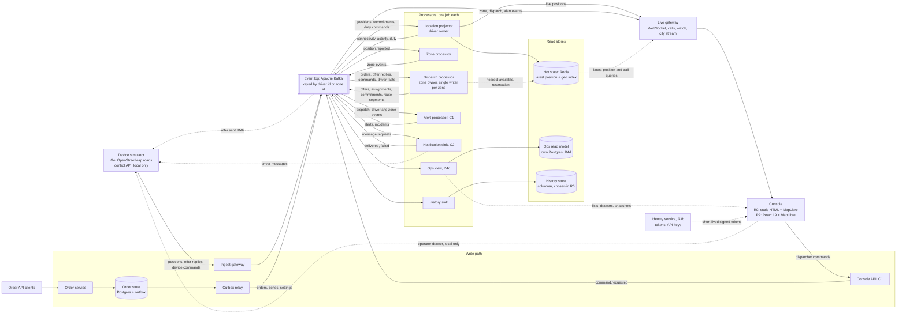
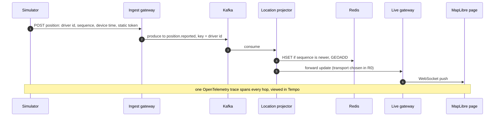
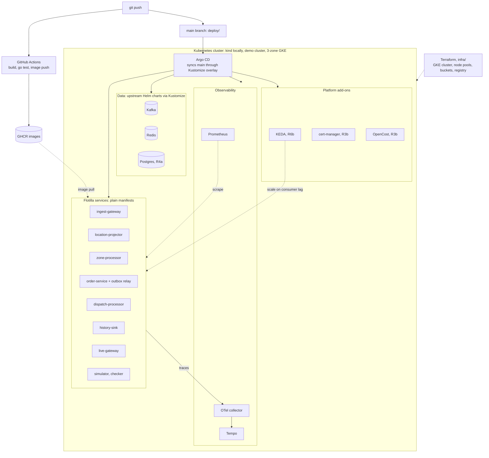
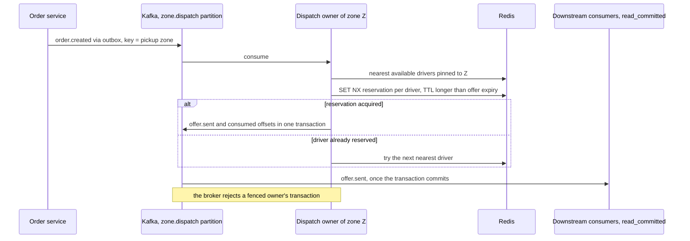

# flotilla-stream

flotilla-stream is a portfolio project: the real-time backbone of a delivery company, built by me to show how I would run one. Simulated drivers stream GPS positions. The system tracks each driver live, raises an event when a driver crosses a geofence, and assigns each order to the nearest available driver with no double assignment, including while a node or a whole zone is down. All traffic is synthetic. There is no real fleet behind it, and `simulator/` generates every driver, position and order you will see. Every number in this README will come from a test in this repo that you can rerun yourself.

**Status:** R0 is open and nothing runs yet. No Go code exists, and `services/`, `deploy/` and `infra/` are empty. Every component and tool below has a status: `R0 (in progress)`, `planned, Rn` or `open, chosen in Rn`. The release plan is in [`docs/releases/`](docs/releases/). The decisions I have made so far, with the alternatives I rejected, are in [`docs/decisions/`](docs/decisions/).

## Why this exists

I'm building this as evidence, not features. It answers one question: can I build and operate a real-time, partitioned, at-least-once system that survives losing a node or an availability zone, and prove it with tests anyone can rerun?

It is written for interviewers and reviewers. The bar I set in the plan is that a stranger can run the local demo from this README, and an interviewer can read the design in ten minutes.

I kept the domain small on purpose: nine entities (fleet, city, driver, position, driver state, zone, order, offer, assignment), so the difficulty sits in the distributed-systems behavior and not in business rules. The system has three jobs:

- Track every driver live and keep the latest position queryable in milliseconds.
- Raise zone entry, exit and dwell events on every position update.
- Assign each order to the nearest available driver, never giving one order to two drivers or two open offers to one driver.

Non-goals, from [`docs/product/PLAN.md`](docs/product/PLAN.md):

- A product for real customers. No billing, merchant onboarding or driver app store release.
- Route optimization. Dispatch is nearest-available with simple rules.
- Turn-by-turn navigation, map tile hosting, or a polished UI beyond a live map and a dashboard.
- Multi-region active-active. One region, multiple availability zones.

## Headline numbers

None yet. This table fills in release by release, and each row will carry the command that produced it. The targets are design targets that R1 confirms or revises.

| Measure | Target | Measured | Release |
| --- | --- | --- | --- |
| Sustained ingest | 50,000 drivers at one update / 5 s = 10,000 events/s | — | R1, R8 |
| Position-to-screen latency | p99 < 500 ms at target load | — | R2, R8 |
| Latest-position query | p99 < 20 ms | — | R1 |
| Assignment latency | p99 < 1 s from order created to driver offered | — | R4a |
| Correctness | zero lost / double assignments, zero position regressions | — | every release, via `checker/` |
| Recovery | consumer lag back to normal within 2 min after losing a node or a zone | — | R9 |
| Elasticity | scale out within 1 min of lag threshold; scale in without loss | — | R6b |
| Cost | per 1,000 drivers per month at target load | — | R8 |

## Architecture

Every write enters through a gateway, the console API or the order service and lands in a partitioned, replayable event log. Independent processors, one job each, turn the log into state, and every read is served from a store shaped for that read. No component reads another component's database.



### A position's life

1. The simulator sends `position.reported` with driver id, device sequence number and device timestamp. In R0 this is one driver posting over HTTP with a static token. From R1 the report is keyed by (device session, sequence) so a rebooted device is not frozen out (decision 4).
2. The ingest gateway validates and normalizes the report and writes it to Kafka, keyed by driver id. From R1 it also drops duplicates by device sequence and sheds load with an explicit retry-after (decision 8).
3. The location projector keeps the report only if it is newer than what is stored, and writes it to Redis (`HSET` plus `GEOADD`, fleet-prefixed keys). It emits `driver.connectivity_changed` (live, stale) from R2 and forwards the live position to the live gateway. The transport for that hop is open and gets chosen in R0.
4. The zone processor emits `zone.entered`, `zone.exited` and `zone.dwell_exceeded` (R3).
5. The history sink batches the report into the history store (R5).
6. The live gateway pushes the update over WebSocket to the MapLibre page. In R0 every update goes to every page. From R2 each dashboard subscribes to map cells and gets at most one update per driver per interval (decision 9).

The live gateway never consumes `position.reported`, so positions reach it only through the projector.

### An order's life

1. An order API client creates an order. The order service writes the order row and an outbox row in one Postgres transaction (R4a, decision 7).
2. The outbox relay publishes `order.created` to `zone.dispatch`, keyed by the pickup zone.
3. The dispatch processor that owns that zone reserves the nearest available driver pinned to the zone, then sends `offer.sent` through its transactional producer (decisions 6 and 13, see [Dispatch without double assignment](#dispatch-without-double-assignment)).
4. In R4a an offer carries one order, is accepted automatically and becomes `assignment.confirmed`. In R4b the device accepts or declines through the ingest gateway, an unanswered offer becomes `offer.expired`, and a driver whose connectivity turns lost has the open offer released (`offer.released`). In R4c one offer can carry several orders from one pickup zone, inserted into the driver's route (decision 16).
5. The simulator reports pickup and delivery as device commands through the ingest gateway, and the zone owner answers with `order.picked_up`, then `order.delivered` or `order.delivery_failed` (R4a), so every order can resolve.
6. The live gateway shows the assignment on the map. From R4d the ops view projects the same events into the console's lists and drawers, and order status for API reads comes from there.

### Components

| Component | Responsibility | State | Scales by | Status |
| --- | --- | --- | --- | --- |
| Device simulator | Drives realistic movement on a real road network for any OpenStreetMap extract and runs load profiles. Adversarial by default: reordering, duplicates, reboots that reset sequence numbers, reconnect storms, clock skew. Honors retry-after. Later also accept, decline, late accepts and disconnects. A control API for the console's operator drawer (Day profile, order bursts, fault injection), deployed in the local overlay only | None | Simulator instances | R0 (in progress), one driver; roads and load in R1; control API C1 |
| Ingest gateway | Authenticates devices, validates and normalizes reports, drops duplicates by device sequence, sheds load with retry-after, writes to the log keyed by driver. Writes device reports that can race a dispatcher (picked up, delivered, failed, duty) as commands | None | Connections and request rate | R0 (in progress); device commands from R4a |
| Event log (Apache Kafka, KRaft mode) | Durable, ordered per partition, replayable, retained for days. The source of truth for movement and decisions | Partitions | Partition count | R0 (in progress), one broker, one topic |
| Location projector | Driver owner. Keeps each driver's latest position (newest wins), the geo index, connectivity (live, stale, lost) and a capped 15-minute trail. Folds every zone owner's commitments into one activity (idle, offered, on route), emits `driver.lost_in_zone` for a lost driver carrying picked-up orders, owns duty commands, and forwards live positions to the live gateway | Hot state store | Partitions consumed | R0 (in progress); connectivity R2, lost R4b; activity R4c; trail R4d; duty and lost-in-zone C1 |
| Hot state store (Redis) | Latest position and status per driver, plus a geo index for nearest queries | In memory, persisted for restart | Memory and shards | R0 (in progress) |
| Live gateway | Holds console connections. Forwards events by map cell, by watched driver id (up to 10) and as a per-city event stream with its true rate and 1-in-N sampling, each event with its topic, partition and offset. Filters by fleet and city before sending. Serves latest-position and 15-minute trail queries from the hot store | Connection state | Connections | R0 (in progress); cells R2; city stream R3; fleet and city filter R3b; trail R4d; watch C1 |
| Zone processor | Runs point-in-polygon tests on each position, emits enter, exit and dwell, keeps per-driver zone membership rebuildable from the log | Local, rebuildable | Partitions consumed | planned, R3 |
| Identity service | Seeded users, roles and allowed cities. Fleet-scoped API keys, hashed and shown once. Issues short-lived signed tokens that the gateways verify locally | Its own store | Request rate (low) | planned, R3b; API keys C2 |
| Order service and outbox relay | Order API and import jobs, zone definitions and fleet settings. Writes each change and an outbox row in one transaction, and the relay publishes them to the log. Order status for API reads comes from the ops view, so the order store holds only what this service writes | Order store (Postgres) | Request rate (low) | planned, R4a; imports C2 |
| Dispatch processor | Zone owner. One writer per zone matches waiting orders to the nearest available driver, sends and releases offers, judges every zone-keyed command, and emits its zone's time-driven facts (order late, late to assign, offer expiry) and, per driver, its commitment and its route segment | In-memory zone state rebuilt from the log, with a checkpoint | Zone partitions; reads `driver.facts` as a broadcast reader, not as a group member | planned, R4a; offer protocol R4b; routes and lateness R4c; dispatcher commands C1 |
| Alert processor | Derives alerts from events, at most one open per kind and subject. Groups them into incidents per kind, zone and window, owns claim and acknowledge commands, and resolves when the condition clears | Local, rebuildable from the log | Zone partitions | planned, C1 |
| Ops view | Projects dispatch, driver, alert and zone-membership events into the console's read model and stores each partition's offset in the same transaction as the rows. Serves lists with server-side paging, counts and search, drawers, Day overview KPIs, and snapshots stamped with their cut offsets. Runs export jobs to object storage | Read model (its own Postgres), object storage for exports | Partitions consumed (projector); request rate (query API) | planned, R4d; Day overview C1; exports C2 |
| Console API | The console's write entry. Checks role, fleet and city and writes `command.requested`. The console reads from the ops view directly | None | Request rate | planned, C1 |
| Notification sink | Delivers driver messages through pluggable channels, device push first, and dedupes by command id | Dedupe set, rebuildable | Partitions consumed | planned, C2 |
| History sink | Batches positions and events into the history store with idempotent writes and retention tiers | History store | Batch size and partitions | planned, R5 |
| History store | Columnar, compressed, cheap: trails, events, analytics queries | Disk | Storage | open, chosen in R5 |

Services are split only where scaling or failure behavior differs. The order service and the dispatch processor share a domain but not a scaling profile, so they are separate. Zone definitions and the order API share both, so they live in one service.

### What R0 builds



R0 leaves out zones, orders, history, scaling, cells, coalescing, metrics dashboards, auth beyond a static token, and dedupe beyond newest-wins. Scope and exit criteria are in [`docs/releases/R0.md`](docs/releases/R0.md).

## The seven invariants

`checker/` asserts these after every test, and a test passes only if the checker passes.

| # | Invariant | First asserted |
| --- | --- | --- |
| 1 | One open offer per driver. A driver never has two open offers at once. A driver may hold many accepted assignments, and an offer may carry several orders | planned, R4a |
| 2 | One order, one driver. An order is never in two open offers or assigned to two drivers | planned, R4a |
| 3 | Every order resolves. After quiescing, every created order ends delivered, failed or cancelled, and none is lost | planned, R4a |
| 4 | Positions never go backwards. A driver's projected latest position never moves to an older device sequence | planned, R1 |
| 5 | Zone events pair up. Every enter has at most one matching exit, and there is no exit without an enter | planned, R3 |
| 6 | Replay equals live. Rebuilding any projection from the log gives the same state as the live projection, compared per driver | planned, R3 |
| 7 | No cross-fleet visibility. No event, live-gateway push or query answer ever reaches a token of another fleet, or a city outside the token's allowed cities (decision 15) | planned, R3b |

The checker runs only after quiescing: load stopped, routes finished, orders still waiting cancelled through commands (from C1; before that, scenarios end with enough drivers that none is left waiting), then every consumer drained to the log's high-water marks, then the assertions. Waiting orders never expire, so the checker reports how many it had to cancel. It dedupes by event id itself, so at-least-once redelivery cannot produce a false violation. Invariant 1 is checked over `offer.sent` and each offer's outcome (accepted, declined, expired, released). For invariant 6, time-driven transitions (`driver.connectivity_changed`, `offer.expired`, `order.late`) are events in the log, consumed on replay and never re-derived from the wall clock.

## Go components

One module, `github.com/Abdelwahab313/flotilla-stream`, on Go 1.27.1 ([`go.mod`](go.mod)), with one binary per component. Go is the runtime for the backend and for every resource-intensive workload (services, simulator and checker), and a second backend runtime needs an ADR. The R0 map is static HTML with MapLibre. From R2 the console is TypeScript, React 19 and MapLibre, built with Vite, and a Go binary serves the built files, so Node runs at build and dev time only and never in production ([decision 17](docs/decisions/0017-console-frontend-stack.md)). R0 needs four binaries: simulator, ingest gateway, location projector and live gateway. Each service gets a folder under `services/`, the simulator lives under `simulator/` and the checker under `checker/`, and each folder name is fixed when its code lands. Responsibilities and release status are in [Components](#components).

Delivery is at-least-once everywhere, so every consumer has a written idempotency rule and there are no exactly-once claims.

| Component | Idempotency rule |
| --- | --- |
| Simulator | Producer only. Duplicates are injected on purpose |
| Ingest gateway | Drop duplicates by device sequence (R1). R0 does no dedupe beyond the projector's newest-wins |
| Location projector | Newest (session, sequence) wins per driver, and a new session is accepted unconditionally (decision 4, R1). R0: newest sequence wins. As driver owner it dedupes duty commands by command id (C1) |
| Live gateway | Coalesces to one update per driver per interval (decision 9, R2) |
| Zone processor | Not written yet, due in R3. Invariants 5 and 6 are its checks |
| Identity service | Not applicable, no log consumer |
| Order service and outbox relay | The relay must be idempotent (decision 7). Import jobs are idempotent on (fleet, external reference) (C2) |
| Dispatch processor | Single writer per zone (decision 6), `SET NX` reservation per driver, and a transactional producer per owned partition, so a fenced owner's writes never commit (decision 13). Commands are deduped by command id over a window checkpointed with the committed offsets |
| Alert processor | At most one open alert per kind and subject, so redelivery does not raise a second alert (C1 exit criterion: alerts per condition = 1) |
| Ops view | Stores each partition's offset in the same transaction as the rows (R4d) |
| Console API | Not a log consumer. Every command carries a client-generated command id, and its owner dedupes by it |
| Notification sink | Dedupes by command id, so a redelivered message event produces one channel send (C2 exit criterion) |
| History sink | Idempotent writes, so a duplicate delivery does not duplicate a history row (R5 exit criterion) |
| Checker, planned, R1 (first invariant: 4) | Dedupes by event id |

## Kubernetes

The same manifests run in every environment, and only the overlay changes between them. Argo CD syncs `main`, and after R0 nothing is applied by hand with `kubectl`.



This table lists the Kubernetes objects. Service status is in [Components](#components) and tool status in [Tools](#tools).

| Component | Kubernetes objects | Notes |
| --- | --- | --- |
| location-projector, zone-processor, dispatch-processor, alert-processor, ops-view projector, notification-sink, history-sink | Deployment with a `preStop` drain-and-commit | KEDA ScaledObject and PodDisruptionBudget in R6b |
| ingest-gateway | Deployment | TLS, token auth and rate limits at the edge before any public exposure (R3b). Connection-based scaling is listed in R6, mechanism open |
| live-gateway | Deployment | Several replicas behind a balancer in R2. Connection-based scaling in R6 |
| simulator, order-service + outbox relay | Deployment | The simulator's control API ships in the `local` overlay only |
| identity-service, console-api, ops-view query API | Deployment | Request-rate services; identity from R3b, ops view from R4d, console API from C1 |
| checker | Runs after quiescing | Object kind not decided. A Job looks like the fit, but that is my assumption |
| Kafka | Strimzi operator: `Kafka` and `KafkaNodePool` resources rendered through Kustomize | One combined KRaft node in R0. Separate controller and broker pools spread over three zones with rack awareness for decision 12 |
| Redis, Postgres | Upstream Helm charts rendered through Kustomize | — |
| Argo CD | Application syncing `main` through the overlay | Must report `Synced`/`Healthy` to close R0. The demo cluster becomes a second target in R3b |
| KEDA | ScaledObject per consumer | Scales on consumer lag, not CPU (decision 11) |
| PodDisruptionBudgets | One per replicated component | Keep a minimum running during maintenance (decision 12). planned, R6b |
| cert-manager | Certificate for the public demo URL | — |
| Secrets | From the platform's secret store | Never a literal in the repo. planned, R3b |

Three rules apply to every manifest. Every resource has requests and limits. Every consumer Deployment has a `preStop` hook that drains in-flight work and commits offsets before exit, because a naive scale-in loses or duplicates work (decision 11). Third-party components come from their upstream Helm charts rendered through Kustomize, my own services are plain manifests, and no Helm chart is written in this repo.

Planned layout, nothing in `deploy/` yet:

```
deploy/
  base/              shared by every environment
  overlays/
    local/           kind, from R0
    demo/            public always-on cluster, from R3b
    gke/             3-zone GKE benchmark, R6a–R9
```

## Dispatch without double assignment

A single writer per zone partition (decision 6) means one order cannot be matched twice. That protects only the order side. A driver near a zone border can be read as available by two zone owners within projector lag and get two offers, and an old owner that is partitioned but still running can keep offering during a rebalance. Decision 13 closes both gaps. A driver is pinned to the owner of its projected current zone, and the owner reserves the driver before offering. Each owner writes through a transactional producer per owned partition, so its outputs and offsets commit together and the broker rejects a fenced owner's writes, and readers use `read_committed`. I rejected filtering by epoch on the reader side, because `driver.facts` gets events from every zone owner and a valid owner's event would be dropped. The reservation is a lock, and I name it as one. It costs one extra round-trip per offer, its failure modes are tested in R9, and the transaction commit cost is measured against the assignment p99. One item is still open for R4a: the reservation lives only in Redis, not in the log, so if Redis restarts while offers are open, a second zone can offer to the same driver. All of this is planned for R4a.



## Delivery pipeline and observability

| Stage | What runs | Status |
| --- | --- | --- |
| Every change | GitHub Actions: build and `go test` | R0 (in progress) |
| Every change | Contract tests on event schemas (backward-compatibility check, decision 10) | planned, R3 |
| Every change | Integration tests against real dependencies in containers | planned, release not set |
| `main` | Images pushed to GHCR, Argo CD syncs the cluster to `deploy/` | R0 (in progress) |
| Cloud | Terraform in `infra/` creates and destroys the GKE environment with one command. It owns cluster, node pools, buckets and registry, never Kubernetes objects | planned, R6a |
| Release tag | Runs that release's demo script and the checker | planned |

Observability:

- **Traces**, propagated through every event, so one position can be followed from device to screen across asynchronous hops.
- **Metrics** per component (rate, errors, duration), per consumer (lag, processing time) and per gateway (connections, shed load), from R1.
- **Logs**, structured and correlated by trace id.
- **Dashboards**: one golden-signals board per component plus one end-to-end SLO board.
- **SLOs** (planned, R7): 99% of updates visible on screen within 1 s, 99.9% of valid reports accepted, 99% of orders offered within 5 s when a driver is available. Each is measured over the 2-hour soak run, because that is how long the system actually runs. Alerts fire on error-budget burn rate, and each has a runbook entry in `docs/runbook/`.

## Tools

Only tools named in the repo's plan, slice files or agent definitions.

| Area | Tool | What it does here | Status |
| --- | --- | --- | --- |
| Language | Go 1.27.1 | Services, simulator and checker | R0 (in progress) |
| Language | TypeScript, with Node at build and dev time only | The console | planned, R2 |
| Language | Go client libraries | Clients for Kafka, Redis, WebSocket and OpenTelemetry | open, chosen in R0 |
| Messaging | Apache Kafka 4.x (KRaft) | The event log | R0 (in progress) |
| Cluster and delivery | Strimzi | Runs Kafka on kind and GKE | R0 (in progress) |
| Messaging | Projector-to-gateway transport | Carries live positions from the location projector to the live gateway | open, chosen in R0 |
| Messaging | Device channel for `offer.sent` | Delivers offers to the simulated device | open, chosen in R4b |
| Storage | Redis | Latest position, geo index, dispatch reservations | R0 (in progress); reservations planned, R4a |
| Storage | Postgres | Order store and transactional outbox; the ops view's read model in its own database | planned, R4a; ops view R4d |
| Storage | History store (columnar) | Trails, events and analytics queries | open, chosen in R5 |
| Edge and UI | WebSocket | Live gateway push to dashboards | R0 (in progress) |
| Edge and UI | Static HTML + MapLibre | The live map in R0 | R0 (in progress) |
| Edge and UI | TypeScript + React 19 + MapLibre, built with Vite | The console, the dispatcher's product UI. Node is a build and dev tool only, and a Go binary serves the built files | planned, R2 |
| Cluster and delivery | `docker compose` | R0 sitting 1: the pipe without Kubernetes, with Kafka, Redis and Tempo | R0 (in progress) |
| Cluster and delivery | kind | Local Kubernetes cluster | R0 (in progress) |
| Cluster and delivery | Kustomize | One base, overlays `local`, `demo` and `gke` | R0 (in progress); `demo` overlay R3b, `gke` R6a |
| Cluster and delivery | Helm (upstream charts) | Third-party components, rendered through Kustomize | R0 (in progress) |
| Cluster and delivery | Argo CD | Syncs `main` to each cluster | R0 (in progress); second target R3b |
| Cluster and delivery | GitHub Actions | Build, `go test`, image push | R0 (in progress) |
| Cluster and delivery | GHCR | Container images | R0 (in progress) |
| Cluster and delivery | Make | `make demo-r0` | R0 (in progress) |
| Cluster and delivery | cert-manager | TLS for the public demo | planned, R3b |
| Cluster and delivery | KEDA | Lag-based autoscaling of consumers | planned, R6b |
| Observability | OpenTelemetry | Trace context carried in every event | R0 (in progress) |
| Observability | OTel collector | Receives and forwards telemetry. R0.md names only Tempo, so whether R0 goes through a collector is open | open, chosen in R0 |
| Observability | Tempo | Trace storage and viewing | R0 (in progress) |
| Observability | Prometheus | Metrics, and one of the two sources `bench-runner` derives numbers from | planned, R1 |
| Observability | Metrics dashboard tool | Golden-signals and SLO boards | open, chosen in R1 |
| Cost | OpenCost | Allocates node and store cost to namespaces and workloads, with a budget alert and cost per 1,000 drivers as a panel (decision 14) | planned, R3b and R8 |
| Cloud | Terraform | The GKE environment as code, in `infra/` | planned, R6a |
| Cloud | GKE, 3 zones | Benchmark cluster for autoscaling, load proof and failure proof, then torn down | planned, R6a–R9 |
| Cloud | Demo cluster: small GKE on spot nodes, or k3s | Always-on public demo, picked by measured monthly cost | open, chosen in R3b |
| Simulation | OpenStreetMap extracts | Road networks for simulator cities. Demos rotate Cairo, Riyadh, Barcelona and Berlin | planned, R1 |

## Decisions

Seventeen records, one page each: Context, Options, Decision, Consequences, How it was tested. All are `proposed` until the release that introduces them accepts them. R0 has to accept 0001, 0003 and 0005.

| # | Decision | Choice | Release |
| --- | --- | --- | --- |
| 0001 | [Source of truth](docs/decisions/0001-source-of-truth.md) | Append-only partitioned event log, and every store is a projection of it | R0 |
| 0002 | [Partition keys](docs/decisions/0002-partition-keys.md) | Positions by driver; orders, offers, assignments and zone events by zone | R0, R4a |
| 0003 | [Delivery guarantee](docs/decisions/0003-delivery-guarantee.md) | At-least-once with idempotent consumers, not exactly-once | R0 |
| 0004 | [Ordering and late data](docs/decisions/0004-ordering-and-late-data.md) | Newest (session, sequence) wins per driver; a new session is accepted unconditionally | R1 |
| 0005 | [Hot path vs cold path](docs/decisions/0005-hot-path-vs-cold-path.md) | Latest state in memory with a geo index, history in a columnar store | R0, R5 |
| 0006 | [Dispatch concurrency](docs/decisions/0006-dispatch-concurrency.md) | Single writer per zone partition | R4a |
| 0007 | [Writes that cross a database and the log](docs/decisions/0007-transactional-outbox.md) | Transactional outbox with an idempotent relay | R4a |
| 0008 | [Backpressure](docs/decisions/0008-backpressure.md) | Bounded queues, gateway sheds with retry-after, consumers pause on lag | R1, R8 |
| 0009 | [Live fan-out](docs/decisions/0009-live-fan-out.md) | Cell subscriptions, one update per driver per interval | R2 |
| 0010 | [Schema evolution](docs/decisions/0010-schema-evolution.md) | Versioned schemas, backward-compatible changes only, checked in the pipeline | R3 |
| 0011 | [Elasticity](docs/decisions/0011-elasticity.md) | Autoscale on lag, not CPU; drain and commit before scale-in | R6b |
| 0012 | [Failure domains](docs/decisions/0012-failure-domains.md) | Stateful components replicated across zones, disruption budgets | R6a, R6b |
| 0013 | [Driver-side exclusivity and owner fencing](docs/decisions/0013-driver-exclusivity-and-owner-fencing.md) | Zone pinning, `SET NX` reservation, fencing through a transactional producer per owned partition | R4a |
| 0014 | [Cost as a measured, pluggable signal](docs/decisions/0014-cost-as-measured-signal.md) | In-cluster cost agent with a pluggable billing adapter, GKE first | R3b, R8 |
| 0015 | [Tenancy model](docs/decisions/0015-tenancy-model.md) | Fleet is the tenant; logical isolation on shared partitions and stores; tokens carry fleet and allowed cities | R3b |
| 0016 | [Planner placement and batching scope](docs/decisions/0016-planner-placement-and-batching-scope.md) | Pure planner inside each zone owner; one offer groups orders from one pickup zone | R4a, R4c |
| 0017 | [Console frontend stack](docs/decisions/0017-console-frontend-stack.md) | TypeScript, React 19, MapLibre, built with Vite; Go serves the static output; client state split by rate | R2 |

## Event catalog

Six topics. Every event carries an event id for dedupe, a schema version, a trace context, the fleet id, the actor for action events, the command id for events that answer a command, and the time it happened at the source.

| Topic | Key | Events | Retention |
| --- | --- | --- | --- |
| `position.reported` | driver id | `position.reported` (R0) | 3 days |
| `driver.facts` | driver id | `driver.connectivity_changed` (R2; lost in R4b); `driver.commitment_changed`, `driver.activity_changed`, `route.updated` (R4c); `driver.duty_changed` (C1); `driver.message_requested`, `driver.message_delivered`, `driver.message_failed`, `driver.message_read` (C2); driver-keyed commands and rejections | 30 days |
| `zone.dispatch` | zone id | `order.created`, `offer.sent`, `assignment.confirmed`, `order.picked_up`, `order.delivered`, `order.delivery_failed` (R4a); `offer.accepted`, `offer.declined`, `offer.expired`, `offer.released` (R4b); `order.late` (R4c); `order.cancelled`, `order.late_to_assign`, `proposal.created`, `proposal.approved`, `proposal.rejected`, `proposal.withdrawn`, `assignment.released` (C1); zone-keyed commands and rejections | 30 days |
| `zone.alerts` | zone id; city id for import results | `alert.raised`, `alert.claimed`, `alert.acknowledged`, `alert.resolved`, `driver.lost_in_zone` (C1); `import.finished` (C2) | 7 days |
| `zone.membership` | zone id | `zone.entered`, `zone.exited`, `zone.dwell_exceeded` (R3) | 7 days |
| `fleet.config` | `fleet:zone` for zones, `fleet` for settings | `zone.defined` (R3 from a seed job, the order service from R4a); `fleet.settings_changed` (C1) | Forever, not compacted |

Each entity's events live in exactly one topic, so a reader can version an entity by the offset of the last event applied to it within that topic and partition, and the live gateway forwards every event with its topic, partition and offset (decision 17). Every producer uses the same partitioner and the fleet-scoped key (`fleet:zone`, `fleet:driver`, decision 15). Event names added after the original thirteen are proposed and get fixed when their slice opens.

A dispatcher action, or a device report that can race one (picked up, delivered, failed, duty), is never a direct write. It is a `command.requested` in the subject's topic, judged in log order by the subject's owner: the dispatch processor for orders, offers and assignments, the alert processor for incidents, the location projector for duty. Every command id gets exactly one answer, either the outcome event carrying that id or `command.rejected` with a reason (`lost_race`, `invalid_state`, `not_eligible`, `not_permitted`, `not_found`). A dispatcher command carries the subject version the dispatcher saw, so a stale one is rejected as `lost_race` and names the events that won. Owners dedupe by command id, and a new owner reads to the high-water mark before answering anything, so a command answered just before a crash is not answered again. Device commands start in R4a and dispatcher commands in C1.

Time-driven facts (connectivity, offer expiry, lateness) run on event time, never the wall clock, so replay produces the same facts. Retention is long enough to rebuild every projection from scratch. The full event table, with the producer and consumers of each event, is in [`docs/product/PLAN.md`](docs/product/PLAN.md).

## Releases

```mermaid
flowchart LR
  R0["R0 Walking skeleton<br/>L, open"] --> R1["R1 Load baseline<br/>M"] --> R2["R2 Live view<br/>M"] --> R3["R3 Zones<br/>M"] --> R3b["R3b Public demo<br/>M"] --> R4a["R4a Dispatch<br/>L"]
  R4a --> V04{{"v0.4 cut"}} --> R4b["R4b Offers<br/>L"] --> R4c["R4c Multi-order routes<br/>M"] --> R4d["R4d Ops view<br/>M"] --> V05{{"v0.5 cut"}}
  V05 --> R5["R5 History<br/>S"] --> C1["C1 Operations console<br/>L"] --> C2["C2 Integrations<br/>M"]
  C2 --> R6a["R6a Cloud env<br/>M"] --> R6b["R6b Elasticity<br/>L"] --> R7["R7 SLOs<br/>S"] --> R8["R8 Load proof<br/>M"] --> R9["R9 Failure proof<br/>M"] --> R10["R10 v1.0<br/>S"]
```



The eighteen slices run in strict order, one open at a time. Sizes are relative (S < M < L, roughly 1 : 1.5 : 2.5) and there are no dates. A slice closes when every exit criterion in its file is ticked and the tag `v0.<n>` exists. R4 is split four ways after review: R4a is single-writer dispatch with one order per offer and is still the v0.4 cut, R4b adds the offer protocol, R4c multi-order routes and R4d the ops view. If interviews take over, the project can stop at either cut line and still stand. Details are in [`docs/releases/`](docs/releases/).

## Run it locally

Not yet. From R0, `make demo-r0` will take a clean checkout to a moving dot on the map on a local kind cluster in under 10 minutes, and the time gets recorded in `docs/results/R0.md`. I will list the prerequisites when R0 closes.

## How this repo is worked

The build is AI-paired. The working rules are in [`CLAUDE.md`](CLAUDE.md), and these three are not covered elsewhere in this README:

- Work happens only inside the open slice. Anything outside its In list goes to that slice's Deferred list.
- Walking skeleton first: the new path exists end to end in its dumbest form before it is made correct, then measured.
- Measured before declared. A number reaches this README only with the command that produced it and a second, independent derivation: an application metric against a log or store count. If the two disagree by more than 2%, the disagreement is the finding and gets written down.

Skills and agents in `.claude/`:

| Name | Kind | What it does |
| --- | --- | --- |
| `/open-slice` | skill | Checks the previous slice is closed and tagged, then creates `docs/releases/Rn.md` from the plan |
| `/close-slice` | skill | Runs the gatekeeper audit, promotes verified numbers to the README, accepts ADRs, tags `v0.<n>` |
| `/record-decision` | skill | Fills an ADR from the slice's work and sends it to `design-critic` |
| `slice-planner` | agent | Turns the open slice into a sitting plan where every step ends in something runnable. Read-only |
| `release-gatekeeper` | agent | Decides from the evidence whether the slice can close, and may run the demo. Read-only |
| `invariant-auditor` | agent | Reviews any diff under `services/`, `checker/` or `simulator/` against the seven invariants and the at-least-once rule |
| `bench-runner` | agent | Runs a scenario, derives every number twice, writes `docs/results/Rn.md`, and never writes to the README |
| `platform-engineer` | agent | Owns `deploy/` and `infra/`, and stops after one sitting without a visible result |
| `design-critic` | agent | Adversarial review of ADRs and L-sized slice plans, ending with one hard interview question |

## Layout

| Path | Contents |
| --- | --- |
| `docs/product/` | The product plan: goals, invariants, decisions, event catalog, evidence plan |
| `docs/design/` | The 10-minute design and results write-up |
| `docs/decisions/` | One record per design decision, 0001–0017 |
| `docs/releases/` | Release plan and the open slice's exit criteria |
| `docs/results/` | Measured numbers per release with the commands that produced them |
| `docs/runbook/` | One entry per alert |
| `services/` | One folder per deployable component (Go) |
| `simulator/` | Device simulator and load profiles |
| `checker/` | Invariant checker |
| `deploy/` | Kustomize manifests shared by every environment (`local`, `demo`, `gke`) |
| `infra/` | Terraform for the GKE environment |
| `demo/` | One demo script per release |
| `.claude/` | The agents and skills this repo is worked with |

## Flotilla

This is the first repo under the Flotilla umbrella. Reserved for later, once the boundaries here are proven: `flotilla-sim` (the simulator on its own), `flotilla-dispatch` (routing and optimization, a non-goal here), `flotilla-connect` (store and courier integrations).
